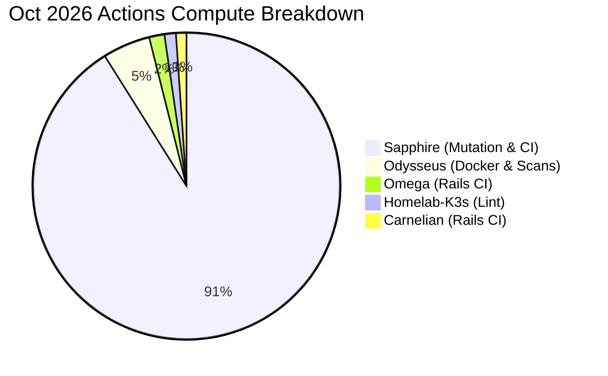
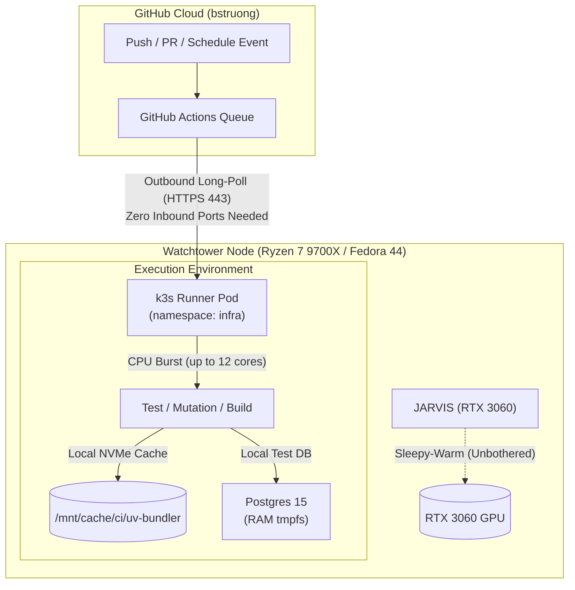

# Watchtower CI Migration Plan: Self-Hosted GitHub Runners on Ryzen 7 9700X

> [!IMPORTANT]
> **Objective:** Eliminate GitHub Actions minute limits permanently by migrating resource-intensive workflows (especially Sapphire's nightly mutation testing, which accounted for ~91% of monthly usage) to the **Watchtower** k3s cluster.
> 
> * **Cloud Quota Used:** 1,800 / 2,000 minutes (90%)
> * **Self-Hosted Cost:** **$0.00 / 0 minutes** consumed on GitHub's quota
> * **Hardware Target:** AMD Ryzen 7 9700X (8c/16t Zen 5 @ 5.58 GHz), Samsung 990 Pro NVMe, 24 GB available DDR5 RAM

---

## 1. Executive Summary & Root Cause Analysis

### The Bottleneck
A review of repository billing telemetry shows that **`sapphire`** consumed **$49.23 out of $54.12 (~91%)** of the entire account's compute allowance. 

The primary consumer was `.github/workflows/mutation-nightly.yml`, which executes `mutmut` mutation testing on a daily `0 8 * * *` schedule across a Postgres service container.



### The Performance Multiplier
GitHub's hosted `ubuntu-latest` runner provides only **2 shared vCPUs and 7 GB RAM** with throttled cloud disk I/O. 

Running these jobs on Watchtower's Ryzen 7 9700X unlocks:
* **4x–6x Parallel Throughput:** Up to 12–16 Zen 5 threads dedicated during compile and mutation passes.
* **NVMe Caching:** Persistent host-path caching for Python `uv`, Ruby `bundler`, and Docker layer caches.
* **Unlimited Minutes:** Zero impact on GitHub's 2,000-minute free tier.

---

## 2. Target Architecture Options



### Comparison of Deployment Models

| Feature | Option 1: K3s Pod Runner (Recommended) | Option 2: Actions Runner Controller (ARC) | Option 3: Host Systemd Service |
| :--- | :--- | :--- | :--- |
| **Description** | Declarative Kubernetes Deployment in `manifests/watchtower/github-runner/` | Official GitHub Kubernetes operator scaling ephemeral runner pods | Direct background daemon on the Fedora host |
| **Simplicity** | High (plain deployment + sealed secret) | Moderate (Helm chart, CRDs, webhook) | High (single shell script) |
| **Isolation** | Containerized within k3s network policies | Fresh ephemeral pod per job | Shared host filesystem |
| **Resource Control** | Governed by Kubernetes requests/limits & CFS | Dynamic pod auto-scaling | Linux cgroups / nice |
| **Recommended For** | **Immediate deployment & steady-state CI** | Enterprise-scale fleet scaling | Bare-metal Docker-in-Docker needs |

---

## 3. Step-by-Step Implementation Blueprint

### Phase 1: Immediate Mitigation (Completed)
- [x] **Scheduled Cron Disabled:** Merged PR [#59 in `sapphire`](https://github.com/bstruong/sapphire/pull/59) to disable the `0 8 * * *` schedule and push triggers in `mutation-nightly.yml`.
- [ ] **Spending Limit Hard Stop:** Verify GitHub spending limit is set to **$0** in [GitHub Billing Settings](https://github.com/settings/billing).

---

### Phase 2: Deploy Self-Hosted Runner on Watchtower K3s

#### Step 1: Generate Registration Token
1. Go to **Repository Settings** (or Account Settings for all repos) -> **Actions** -> **Runners** -> **New self-hosted runner**.
2. Copy the token provided under the registration command.

#### Step 2: Seal Runner Secrets
Using the homelab secret workflow:
```bash
# In homelab-k3s workspace
./scripts/secrets.sh seal-generic github-runner-token infra \
  token="<GITHUB_RUNNER_REGISTRATION_TOKEN>" \
  > manifests/watchtower/github-runner/sealedsecret.yaml
```

#### Step 3: Create Manifests (`manifests/watchtower/github-runner/`)

* **`deployment.yaml`**:
```yaml
apiVersion: apps/v1
kind: Deployment
metadata:
  name: github-runner-sapphire
  namespace: infra
spec:
  replicas: 1
  strategy:
    type: Recreate
  selector:
    matchLabels:
      app: github-runner-sapphire
  template:
    metadata:
      labels:
        app: github-runner-sapphire
    spec:
      containers:
        - name: runner
          image: myoung34/github-runner:ubuntu-noble
          env:
            - name: REPO_URL
              value: "https://github.com/bstruong/sapphire"
            - name: RUNNER_TOKEN
              valueFrom:
                secretKeyRef:
                  name: github-runner-token
                  key: token
            - name: RUNNER_NAME
              value: "watchtower-9700x-01"
            - name: RUNNER_LABELS
              value: "self-hosted,watchtower,x64,zen5"
            - name: EPHEMERAL
              value: "1"
          resources:
            requests:
              cpu: "500m"
              memory: "1Gi"
            limits:
              cpu: "12000m"      # Bursts up to 12 Zen 5 threads
              memory: "12Gi"     # Uses a fraction of Watchtower's 24GB free RAM
          volumeMounts:
            - name: runner-cache
              mountPath: /cache
      volumes:
        - name: runner-cache
          hostPath:
            path: /mnt/appdata/ci-cache
            type: DirectoryOrCreate
```

---

### Phase 3: Migrate Sapphire Workflows

Update `.github/workflows/mutation-nightly.yml`:

```yaml
jobs:
  mutation:
    name: Mutation Testing (Watchtower Zen 5)
    # Changed from ubuntu-latest:
    runs-on: [self-hosted, watchtower]
```

#### Re-enable the Cron Schedule
Once verified on the self-hosted runner, uncomment the cron trigger:
```yaml
on:
  schedule:
    - cron: "0 8 * * *"
  workflow_dispatch:
```
Because the job runs on `[self-hosted, watchtower]`, it will execute every night, complete 3x faster, and consume **0 minutes** of your GitHub cloud allowance.

---

### Phase 4: Account-Level Rollout Across Repos

Once `sapphire` is validated, register an **Account-Level Runner** under `https://github.com/settings/actions_runners`. 

This enables all your personal repositories to use the runner:

| Repository | Current Hosted Cost | Target Workflow | Migration Benefit |
| :--- | :---: | :--- | :--- |
| **`sapphire`** | $49.23 | `mutation-nightly.yml`, `ci.yml` | Eliminates 91% of account usage |
| **`odysseus`** | $2.73 | `docker-publish.yml`, `ci.yml` | Multi-core container builds with local layer caching |
| **`omega`** | $0.86 | `ci.yml` | Rails 8 + Minitest runs in seconds |
| **`carnelian`** | $0.62 | `ci.yml` | Rails 8 test suite |
| **`homelab-k3s`** | $0.67 | `ci.yaml` | Instant cluster validation & yamllint |

---

## 4. Invariants & Security Guardrails

1. **Private Repositories Only:**  
   > [!CAUTION]
   > Never attach a self-hosted runner to public open-source repositories without strict PR approval gates. For your private repos (`bstruong/*`), it is completely safe.
2. **Network Isolation:**  
   The runner pod requires only **outbound HTTPS (port 443)** to GitHub. No router port forwarding or incoming firewall exceptions are needed on Watchtower.
3. **No JARVIS Contention:**  
   The runner uses pure CPU/RAM. The RTX 3060 remains parked in sleepy-warm mode unless JARVIS is called for model inference.
