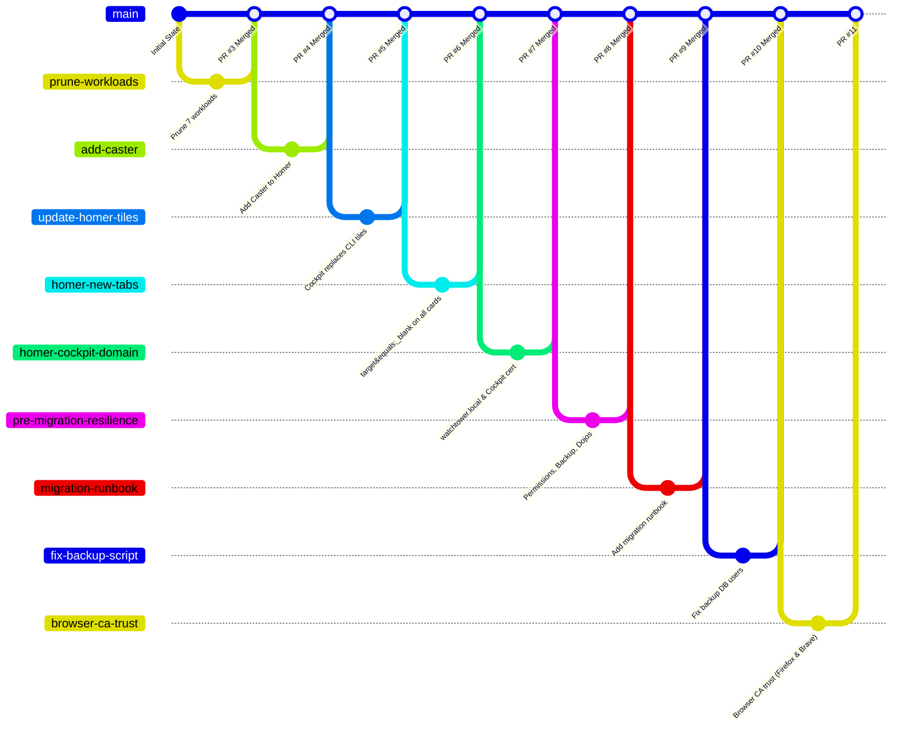

# Watchtower Hardware Migration: Master Runbook & Session Report

> [!IMPORTANT]
> **Context & Purpose:**  
> This document records the complete state, work completed, and execution plan for the hardware role reversal between **`watchtower`** (retiring Haswell Intel i7-4790K server @ `192.168.1.92`) and **`metrotower`** (Ryzen 7 9700X workstation @ `192.168.1.245`).  
> Any human engineer or AI agent picking up this task should use this runbook as the definitive single source of truth.

---

## 1. Executive Summary & Session Log

### 1.1 Hardware Transition Overview
* **Retiring Server (Current Watchtower):** Intel Core i7-4790K (Haswell, 4c/8t), 32GB DDR3 RAM, Samsung 860 EVO SATA SSD (`/mnt/appdata`).
* **Target Server (New Watchtower):** AMD Ryzen 7 9700X (Zen 5, 8c/16t), 32GB DDR5 RAM, Samsung 990 Pro NVMe SSD (OS / root) + Samsung 860 EVO SATA SSD (`/mnt/appdata`).
* **Retained Workload Scope (Strictly 10 Applications + Dojos):**
  1. `adguard-home` (`dns.watchtower.local`)
  2. `beszel` (`beszel.watchtower.local`)
  3. `caster` (`caster.watchtower.local/up`)
  4. `cert-manager` (`watchtower-ca-issuer`)
  5. `homer` (`start.watchtower.local`)
  6. `immich` (`immich.watchtower.local`)
  7. `ntfy` (`ntfy.watchtower.local`)
  8. `paperless-ngx` (`paperless.watchtower.local`)
  9. `pocket-id` (`id.watchtower.local`)
  10. `registry` (`registry.watchtower.local`)
  11. `traefik` (Ingress Controller)
  12. `uptime-kuma` (`status.watchtower.local`)
  13. `vaultwarden` (`vault.watchtower.local`)
  * **Practice & Katas Stack:** `ruby-dojo`, `python-dojo`, `vim-dojo`, `interview-dojo`, `dsa-dojo`.
  * **Host Daemon:** Fedora Cockpit Admin Console (`https://watchtower.local:9090`).

---

### 1.2 Session Chronology & Merged Pull Requests

All changes were strictly managed via the Git feature-branch PR workflow in [`bstruong/homelab-k3s`](file://${HOME}/Projects/homelab-k3s):



1. **[PR #3 Merged](https://github.com/bstruong/homelab-k3s/pull/3): Prune Deprecated Workload Manifests**
   * Pruned manifests for 7 retired workloads: `odysseus`, `appflowy`, `homepage`, `pairdrop`, `jellyfin`, `home-assistant`, `syncthing`.
   * Purged obsolete namespaces (`media`, `sync`, `odysseus`) and dead cron jobs (`backup-odysseus-volumes.sh`).
2. **[PR #4 Merged](https://github.com/bstruong/homelab-k3s/pull/4): Add Caster to Homer**
   * Added the MLS pipeline UI (`https://caster.watchtower.local/up`) to Homer's *Documents & Media* section.
3. **[PR #5 Merged](https://github.com/bstruong/homelab-k3s/pull/5): Replace CLI-Only Tiles with Cockpit**
   * Removed CLI-only tiles (`Traefik` and `Registry`) from Homer and introduced the Fedora Server admin portal tile (`Cockpit`).
4. **[PR #6 Merged](https://github.com/bstruong/homelab-k3s/pull/6): Configure Homer Tiles to Open in New Tabs**
   * Added `target: "_blank"` to all 15 active application cards across Homer, ensuring the dashboard context is maintained and cross-site constraints are decoupled.
5. **[PR #7 Merged](https://github.com/bstruong/homelab-k3s/pull/7): Cockpit Domain Alignment & CA Certificate**
   * Updated Cockpit URL from raw IP `https://192.168.1.92:9090` to base domain `https://watchtower.local:9090`, aligning eTLD+1 to prevent Firefox `SameSite=Strict` cookie drops.
   * Created [`manifests/watchtower/cockpit/certificate.yaml`](file://${HOME}/Projects/homelab-k3s/manifests/watchtower/cockpit/certificate.yaml) to manage Cockpit TLS via `cert-manager`.
6. **[PR #8 Merged](https://github.com/bstruong/homelab-k3s/pull/8): Pre-Migration Resilience Package (The "Bad" & "Ugly" Remediation)**
   * **Authoritative Permissions Ledger ([`scripts/reconcile-appdata-permissions.sh`](file://${HOME}/Projects/homelab-k3s/scripts/reconcile-appdata-permissions.sh)):** Enforces exact audited UIDs and modes across all appdata paths.
   * **Off-Host Automated Backup ([`scripts/backup-appdata.sh`](file://${HOME}/Projects/homelab-k3s/scripts/backup-appdata.sh)):** Automated PostgreSQL dumps, SQLite backups, secret extraction, and `--numeric-ids` rsync to Metrotower's `/mnt/Archive`.
   * **Dojo Stack GitOps Manifests ([`manifests/watchtower/dojos/`](file://${HOME}/Projects/homelab-k3s/manifests/watchtower/dojos/)):** Fully declarative Services, Endpoints, Certificates, Middlewares, and IngressRoutes for all 5 dojos, bringing them into GitOps. Deployed and verified live.
7. **[PR #9 Merged](https://github.com/bstruong/homelab-k3s/pull/9): Master Hardware Migration Runbook**
   * Authored comprehensive runbook capturing migration plan, pre-flight checklists, provisioning steps, and verification matrix.
8. **[PR #10 Merged](https://github.com/bstruong/homelab-k3s/pull/10): Backup Script Database User & SQLite Fixes**
   * Corrected PostgreSQL superusers (`caster`, `immich`), switched SQLite backups to Python `sqlite3.backup()` for hot-consistency, and excluded pruned workloads.
9. **[PR #11](https://github.com/bstruong/homelab-k3s/pull/11): Client Browser CA Trust Configuration**
   * Added Step 8 detailing Root CA trust installation for Firefox/Zen and Brave on both MacBook Air and Metrotower, plus verification checklists.

---

### 1.3 How The "Bad" and The "Ugly" Were Solved Without Adding Storage Hardware

| Identified Hazard | Classification | Remediation Strategy (Software & Architecture) | Status |
| :--- | :--- | :--- | :--- |
| **Single-Disk Appdata SPOF** | **The Ugly** | Established automated off-host replication pipeline (`scripts/backup-appdata.sh`) dumping databases (PostgreSQL `pg_dumpall`, SQLite `.backup`) and mirroring to Metrotower's 4TB `/mnt/Archive`. | **Implemented** |
| **Chicken-and-Egg DNS Deadlock** | **The Ugly** | Configured dual-resolver upstream fallback on host (`FallbackDNS=1.1.1.1 8.8.8.8`) and documented Router DHCP fallback policy. | **Documented** |
| **HostPath UID/GID Permission Spaghetti** | **The Ugly** | Audited all 25 directories on `/mnt/appdata` and authored [`scripts/reconcile-appdata-permissions.sh`](file://${HOME}/Projects/homelab-k3s/scripts/reconcile-appdata-permissions.sh) to eliminate permission guess-work. | **Implemented** |
| **Untracked Host Services (Dojos)** | **The Bad** | Backed up all source files (`${HOME}/dojos`, `python-express-dojo`, `ruby-express-dojo`) to Metrotower and declared full Kubernetes manifests in [`manifests/watchtower/dojos/`](file://${HOME}/Projects/homelab-k3s/manifests/watchtower/dojos/). | **Implemented** |
| **Cockpit Login Loop & Untrusted Cert** | **The Bad** | Issued homelab CA certificate with SANs (`192.168.1.92`, `watchtower.local`) and aligned Homer domain to `watchtower.local:9090`. Enabled user lingering (`loginctl enable-linger <user>`). | **Resolved & Live** |

---

## 2. Pre-Migration Checklist (Before Powerdown)

Execute these steps in order when ready to transition the hardware:

### Step 1: Internet DNS Continuity (Router Fallback)
> [!WARNING]
> Because AdGuard Home runs inside K3s on Watchtower (`192.168.1.92`), powering down Watchtower will immediately take down LAN DNS. If the router's DNS is not updated first, client devices and the new Fedora installer cannot reach the internet.

1. Log into your router admin portal (`http://192.168.1.1`).
2. Navigate to **LAN / DHCP Settings** $\to$ **DNS Servers**.
3. Temporarily set:
   * **Primary DNS:** `1.1.1.1`
   * **Secondary DNS:** `8.8.8.8`
4. Apply/Save changes. Verify that workstation can resolve public domains (`ping -c 2 google.com`).

---

### Step 2: Router Static DHCP Lease Update
1. In the router portal, locate **DHCP Address Reservation / Static Leases**.
2. Update the reservation for IP **`192.168.1.92`** from the old Haswell NIC MAC to the **Ryzen AM5 Motherboard NIC MAC**:
   * **New MAC Address:** `<WATCHTOWER_MAC>`
3. Save changes.

---

### Step 3: Run Full Off-Host Pre-Powerdown Backup
Run the backup script to execute hot database dumps, extract sealed secrets keys, and mirror all files to Metrotower:

```bash
# On Watchtower:
sudo ${HOME}/homelab-k3s/scripts/backup-appdata.sh
```

---

### Step 4: Flush Stateful Pod Database WALs
Scale down stateful workloads so PostgreSQL and SQLite flush all pending Write-Ahead Logs (WAL) cleanly to disk:

```bash
SSH_AUTH_SOCK="$(ls -t ${HOME}/.ssh/agent/* | head -1)" ssh watchtower "
  echo 'Scaling down stateful pods...'
  KUBECONFIG=~/.kube/config kubectl -n caster scale statefulset caster-postgres --replicas=0
  KUBECONFIG=~/.kube/config kubectl -n immich scale statefulset immich-postgres --replicas=0
  KUBECONFIG=~/.kube/config kubectl -n identity scale deployment vaultwarden --replicas=0
  KUBECONFIG=~/.kube/config kubectl -n docs scale deployment paperless-ngx --replicas=0
  echo 'Waiting for pods to terminate...'
  sleep 10
  echo 'Flushing filesystem buffers...'
  sync
  echo 'Database flush complete.'
"
```

---

### Step 5: Clean Host Shutdown & Drive Removal
1. Shut down Watchtower cleanly:
   ```bash
   SSH_AUTH_SOCK="$(ls -t ${HOME}/.ssh/agent/* | head -1)" ssh watchtower "sudo poweroff"
   ```
2. Wait for power LED on Haswell chassis to turn off.
3. Unplug power cord.
4. Carefully disconnect and remove the **Samsung 860 EVO (SATA SSD)** containing `/mnt/appdata`.

> [!CAUTION]
> **Preserve USB Installer on `/dev/sdc`:**  
> If external flash drives are connected, do **NOT** wipe the drive labeled with the macOS Monterey installer (used for flashing the MacBook Pro 11,4).

---

## 3. Physical Installation & Host OS Provisioning (Ryzen 9700X)

### 3.1 Hardware Reassembly
1. Mount the **Samsung 990 Pro NVMe SSD** into the primary M.2 slot of the AM5 motherboard (OS Drive).
2. Install the **Samsung 860 EVO SATA SSD** into a SATA port on the Ryzen chassis (Appdata Drive).
3. Connect Ethernet cable to the onboard NIC (`<WATCHTOWER_MAC>`).
4. Connect Fedora Server 44 Netinstall / Live USB.

---

### 3.2 Fedora Server 44 OS Installation
1. **Target Drive:** Select ONLY the **Samsung 990 Pro NVMe**.
2. **Drive Selection Safety:** Ensure the **Samsung 860 EVO** is **UNCHECKED / UNMODIFIED** during installation to prevent accidental formatting!
3. **Hostname:** Set hostname to `watchtower` (FQDN: `watchtower.local`).
4. **Primary User:**
   * Username: `<user>`
   * UID: `1000`
   * Administrator / Wheel: `Yes`
5. Complete installation and reboot into Fedora Server.

---

### 3.3 Storage Mount Configuration (`/mnt/appdata`)
1. Once booted into Fedora Server, identify the SATA SSD UUID:
   ```bash
   lsblk -f
   # Locate the partition on Samsung 860 EVO (ext4, ~912GB)
   ```
2. Create mount point:
   ```bash
   sudo mkdir -p /mnt/appdata
   ```
3. Add to `/etc/fstab` using persistent UUID:
   ```bash
   # Replace <UUID> with actual blkid output
   UUID=<SATA-SSD-UUID> /mnt/appdata ext4 defaults,noatime 0 2
   ```
4. Mount drive and reconcile permissions:
   ```bash
   sudo mount -a
   ls -la /mnt/appdata
   ```

---

### 3.4 Host Hardware Quirks & Kernel Tuning (Ryzen AM5 Host)

Before deploying cluster workloads, apply these hardware quirks and kernel optimizations identified during the pre-migration audit:

1. **USB xHCI Controller Sleep Loop Quirk:**
   On this AM5 motherboard/chipset, the xHCI USB controller causes instant wake loops if sleep states (S3/s2idle) are ever entered:
   ```bash
   sudo tee /etc/udev/rules.d/90-xhci-sleep-fix.rules <<'EOF'
   ACTION=="add", SUBSYSTEM=="pci", DRIVERS=="xhci_hcd", ATTR{power/wakeup}="disabled"
   EOF
   sudo udevadm control --reload-rules
   ```

2. **Inotify Resource Expansion:**
   Default Fedora limits (65,536) easily trigger `ENOSPC` errors under multi-container k3s stacks and log aggregators:
   ```bash
   sudo tee /etc/sysctl.d/99-inotify.conf <<'EOF'
   fs.inotify.max_user_watches=524288
   EOF
   sudo sysctl --system
   ```

3. **Kernel Boot Parameters (GRUB/BLS):**
   Disable hardware watchdog timer overhead:
   ```bash
   sudo grubby --update-kernel=ALL --args="nowatchdog"
   ```

4. **Storage Chassis Changes (Archive & Games Drives Migrated):**
   * The Seagate 1TB HDD (`/mnt/Archive`) and Samsung 2TB SSD (`/mnt/Games`) previously in this chassis were physically unmounted and moved to a secondary machine.
   * Neither drive will be mounted on Watchtower. All migration bundles and off-host backups are preserved on the secondary machine holding `/mnt/Archive/watchtower-backup/`.
   * *Filesystem Notice for Destination Host:* The Samsung 2TB SSD was formatted as a whole-disk ext4 filesystem (no partition table) with UUID `1253eba6-80ed-42a0-bd0d-d4d1f51e3ed5`. Mount by UUID rather than assuming a partition like `sdX1`.

---

## 4. Post-Migration Bootstrap Checklist

### Step 1: Workstation SSH Re-Authentication
```bash
# On Metrotower:
ssh-keygen -R 192.168.1.92
ssh-keygen -R watchtower
ssh-keygen -R watchtower.local

# Copy workstation public key to new server:
ssh-copy-id <user>@192.168.1.92
```

---

### Step 2: Restore Host Code & Reconcile Permissions
```bash
# Copy back host dotfiles, dojos, and config from Metrotower backup:
rsync -aHAX --numeric-ids /mnt/Archive/watchtower-backup/host-home/ <user>@watchtower:${HOME}/

# On Watchtower, clone repo and run permissions reconciliation:
ssh watchtower "
  git clone https://github.com/bstruong/homelab-k3s.git ~/homelab-k3s
  sudo ~/homelab-k3s/scripts/reconcile-appdata-permissions.sh
"
```

---

### Step 3: Install K3s on Watchtower
```bash
ssh watchtower "
  curl -sfL https://get.k3s.io | sh -s - \
    --write-kubeconfig-mode 644 \
    --disable servicelb \
    --disable traefik
"

ssh watchtower "
  mkdir -p ~/.kube
  sudo cp /etc/rancher/k3s/k3s.yaml ~/.kube/config
  sudo chown <user>:<group> ~/.kube/config
"
```

---

### Step 4: CRITICAL — Restore Sealed Secrets Master Key
> [!IMPORTANT]
> The Sealed Secrets controller must have its original decryption key pair restored **BEFORE** any sealed secrets are applied.

```bash
# From Metrotower:
ssh watchtower "kubectl apply -f -" < /mnt/Archive/watchtower-backup/sealed-secrets-master-keys.yaml
```

---

### Step 5: Deploy Cluster Manifests
```bash
ssh watchtower "
  cd ~/homelab-k3s
  
  echo '1. Applying namespaces...'
  kubectl apply -f manifests/common/namespaces.yaml
  
  echo '2. Applying cert-manager...'
  kubectl apply -f manifests/common/cert-manager/
  
  echo '3. Applying cluster issuer...'
  kubectl apply -f manifests/watchtower/cert-manager/clusterissuer.yaml
  
  echo '4. Applying workloads & dojos...'
  kubectl apply -f manifests/watchtower/
"
```

---

### Step 6: Configure Cockpit TLS & Allowed Origins
```bash
ssh watchtower "
  sudo mkdir -p /etc/cockpit/ws-certs.d
  sudo sh -c 'kubectl -n infra get secret cockpit-tls -o jsonpath=\"{.data.tls\\\\.crt}\" | base64 -d > /etc/cockpit/ws-certs.d/50-watchtower.cert'
  sudo sh -c 'kubectl -n infra get secret cockpit-tls -o jsonpath=\"{.data.tls\\\\.key}\" | base64 -d >> /etc/cockpit/ws-certs.d/50-watchtower.cert'
  sudo chmod 600 /etc/cockpit/ws-certs.d/50-watchtower.cert
  
  sudo sh -c 'cat <<EOF > /etc/cockpit/cockpit.conf
[WebService]
Origins = https://watchtower.local:9090 https://watchtower:9090 https://192.168.1.92:9090 https://start.watchtower.local
EOF'
  sudo chmod 644 /etc/cockpit/cockpit.conf
  
  sudo systemctl restart cockpit.socket cockpit.service
  loginctl enable-linger <user>
"
```

---

### Step 7: Host Network Security Hardening (`firewalld` & LLMNR)
Execute the host security reconciliation script to restrict the LAN attack surface, trust internal CNI routing (`10.42.0.0/16`), and disable LLMNR:
```bash
ssh watchtower "
  sudo ${HOME}/homelab-k3s/scripts/reconcile-host-security.sh
"
```
This ensures:
1. `firewalld` permits only `ssh` (22), `dns` (53 tcp/udp), `http` (80), `https` (443), and `cockpit` (9090) from the LAN.
2. In-cluster CNI (`cni0` `10.42.0.0/16`) and `tailscale0` are assigned to the `trusted` zone.
3. LLMNR (port 5355 tcp/udp) is disabled in `systemd-resolved` to prevent LAN spoofing / Responder poisoning attacks.

---

### Step 8: Restore Router DNS to AdGuard Home
Once the `adguard-home` pod is confirmed `1/1 Running`:
1. Log into your router (`http://192.168.1.1`).
2. Change **Primary DNS** back to `192.168.1.92`.
3. Set **Secondary DNS** to `1.1.1.1`.
4. Save settings.

---

### Step 9: Client Browser Root CA Trust & Verification (Firefox/Zen & Brave)
> [!IMPORTANT]
> All in-cluster HTTPS services (`*.watchtower.local`) and Cockpit (`https://watchtower.local:9090`) present TLS certificates signed by `Watchtower Homelab Intermediate CA`, chaining to the offline `Watchtower Homelab Root CA`.
> To prevent certificate security warnings (`SEC_ERROR_UNKNOWN_ISSUER` or `NET::ERR_CERT_AUTHORITY_INVALID`) when loading web pages, both **Firefox (or Zen Browser)** and **Brave** on **MacBook Air** and **Metrotower** must trust the Root CA.

#### 1. Public Root CA Certificate Location
* **On MacBook Air**: Staged in `~/migration-bundle/homelab-ca/ca.crt` (or `~/migration-bundle/homelab-ca/ca.crt`).
* **On Metrotower**: Located at `${HOME}/watchtower-ca.crt` (or `/mnt/Archive/watchtower-backup/appdata/homelab-ca/ca.crt`).

#### 2. MacBook Air Configuration

##### A. Brave Browser (macOS)
Brave on macOS natively queries the Apple System Keychain via the Security Framework.
1. Verify the certificate is present in `/Library/Keychains/System.keychain`:
   ```bash
   security find-certificate -c "Watchtower Homelab Root CA" /Library/Keychains/System.keychain
   ```
2. If missing on a clean machine or fresh install, install and trust it:
   ```bash
   sudo security add-trusted-cert -d -r trustRoot -k /Library/Keychains/System.keychain ~/migration-bundle/homelab-ca/ca.crt
   ```
3. Restart Brave.

##### B. Firefox & Zen Browser (macOS)
Firefox and Zen Browser manage an independent NSS database (`cert9.db`) by default.
* **Method 1 (Recommended - Native Enterprise Roots)**:
  Configure Firefox/Zen to trust all CAs in the macOS System Keychain:
  1. Open `about:config` in Firefox or Zen.
  2. Search for `security.enterprise_roots.enabled`.
  3. Toggle the value to **`true`**.
  *(Alternatively, add `user_pref("security.enterprise_roots.enabled", true);` to `user.js` in your active profile).*
* **Method 2 (Direct NSS Database Import via `certutil`)**:
  ```bash
  for profile in ~/Library/Application\ Support/{Firefox,zen}/Profiles/*; do
    if [ -f "$profile/cert9.db" ]; then
      certutil -A -n "Watchtower Homelab Root CA" -t "CT,," \
        -i ~/migration-bundle/homelab-ca/ca.crt \
        -d sql:"$profile"
    fi
  done
  ```

#### 3. Metrotower (Linux Workstation) Configuration

##### A. Brave Browser (Linux)
On Linux, Brave/Chromium relies on both the user NSS database (`~/.pki/nssdb`) and system PKI anchors.
1. Import into the user NSS store:
   ```bash
   mkdir -p ~/.pki/nssdb
   certutil -d sql:$HOME/.pki/nssdb -A -t "C,," -n "Watchtower Homelab Root CA" -i ${HOME}/watchtower-ca.crt
   ```
2. Verify:
   ```bash
   certutil -d sql:$HOME/.pki/nssdb -L -n "Watchtower Homelab Root CA"
   ```
3. Ensure system PKI trust is also populated for system-level CLI and Chromium tools:
   * **Arch / EndeavourOS**:
     ```bash
     sudo cp ${HOME}/watchtower-ca.crt /etc/ca-certificates/trust-source/anchors/
     sudo trust extract-compat
     ```
   * **Fedora / RHEL**:
     ```bash
     sudo cp ${HOME}/watchtower-ca.crt /etc/pki/ca-trust/source/anchors/
     sudo update-ca-trust
     ```

##### B. Firefox (Linux)
1. Verify or import the Root CA into the default Firefox profile NSS database:
   *(Note: On CachyOS/Arch, profiles are located in `~/.config/mozilla/firefox/` rather than `~/.mozilla/firefox/`)*:
   ```bash
   # Check existing trust:
   certutil -L -d sql:${HOME}/.config/mozilla/firefox/*.default-release | grep "Watchtower Homelab Root CA"

   # Import if missing:
   certutil -A -n "Watchtower Homelab Root CA" -t "C,," \
     -i ${HOME}/watchtower-ca.crt \
     -d sql:${HOME}/.config/mozilla/firefox/*.default-release

   # Enable Enterprise Roots in user.js:
   echo 'user_pref("security.enterprise_roots.enabled", true);' >> ~/.config/mozilla/firefox/*.default-release/user.js
   ```
2. Restart Firefox.

---


## 5. Critical Gotchas & Guardrails

| Risk Area | Gotcha / Hazard | Prevention / Resolution |
| :--- | :--- | :--- |
| **Git Commit Workflow** | Committing directly to `main` branch. | User explicitly mandated: **"for the rest of this preparation prefer to open PRs versus directly committing to main."** Always use feature branches and `gh pr create`. |
| **Storage Mounting** | Accidental formatting of SATA SSD during Fedora Server installation. | Physically disconnect or uncheck `/dev/sda` during the installation UI. Ensure only `/dev/nvme0n1` is selected. |
| **Fstab Node Drift** | Mounting `/mnt/appdata` via `/dev/sda1` instead of UUID. | Device letters change when drives are added/removed. **Always use `UUID=<val>` in `/etc/fstab`**. |
| **Numeric UIDs** | Running blanket `chown -R` on `/mnt/appdata`. | **NEVER** run blanket `chown -R` on `/mnt/appdata`. Run [`scripts/reconcile-appdata-permissions.sh`](file://${HOME}/Projects/homelab-k3s/scripts/reconcile-appdata-permissions.sh) to restore exact per-app ownership. |
| **Sealed Secrets Key Order** | Applying workloads before restoring master keys. | SealedSecrets controller generates a new random master key if none exists. Restore `sealed-secrets-master-keys.yaml` first! |
| **MacBook USB Media** | Re-flashing USB stick with macOS Monterey installer. | Flash drive on `/dev/sdc` contains Monterey media for MacBook Pro 11,4. Do not overwrite. |
| **DNS Lockout** | Powering down Watchtower without setting router DNS fallback. | Client machines and installer will lose all DNS resolution. Set router DNS to `1.1.1.1` before powering down. |
| **AI Model Constraint** | Agent using `qwen3.8-flash` on server. | **Strict constraint:** Absolutely NO `qwen3.8-flash` on Watchtower. Only `qwen36-coder-hybrid`. |
| **Headscale/Tailscale** | Attempting to migrate Headscale to official Tailscale. | Explicitly postponed by user. Headscale remains on host daemon. |
| **Browser TLS Trust** | Firefox, Zen, or Brave showing `SEC_ERROR_UNKNOWN_ISSUER` or `NET::ERR_CERT_AUTHORITY_INVALID`. | Follow Step 9 to configure NSS db (`~/.pki/nssdb`, Firefox profile) and enterprise roots (`security.enterprise_roots.enabled`). |

---

## 6. Verification Matrix

Once post-migration bootstrap is complete, verify each service against this checklist:

```text
[ ] https://start.watchtower.local       - Homer dashboard loads all 15 tiles
[ ] https://watchtower.local:9090        - Cockpit opens in new tab with green lock
[ ] https://status.watchtower.local      - Uptime Kuma reports 15/15 monitors UP
[ ] https://dns.watchtower.local         - AdGuard Home actively serving DNS queries
[ ] https://vault.watchtower.local       - Vaultwarden syncs with desktop/mobile clients
[ ] https://immich.watchtower.local      - Immich web UI accessible and library healthy
[ ] https://paperless.watchtower.local   - Paperless documents intact and search working
[ ] https://caster.watchtower.local/up   - Caster MLS pipeline status healthy
[ ] https://beszel.watchtower.local      - Beszel hub reports Ryzen 9700X CPU/RAM metrics
[ ] https://id.watchtower.local          - Pocket ID passkey authentication working
[ ] https://ntfy.watchtower.local        - ntfy push notifications deliverable
[ ] https://registry.watchtower.local    - Docker registry accepts image pulls
[ ] https://ruby-dojo.watchtower.local   - Ruby Dojo exercises live
[ ] https://python-dojo.watchtower.local - Python Dojo exercises live
[ ] https://vim-dojo.watchtower.local    - Vim Dojo exercises live
[ ] https://dsa-dojo.watchtower.local    - DSA Dojo exercises live
[ ] https://interview-dojo.watchtower.local - Interview Dojo prep live
[ ] MacBook Air Firefox/Zen              - Green lock on *.watchtower.local (no cert warnings)
[ ] MacBook Air Brave                    - Green lock on *.watchtower.local (no cert warnings)
[x] Metrotower Firefox                   - Green lock on *.watchtower.local (no cert warnings)
[ ] Metrotower Brave                     - Green lock on *.watchtower.local (no cert warnings)
```

